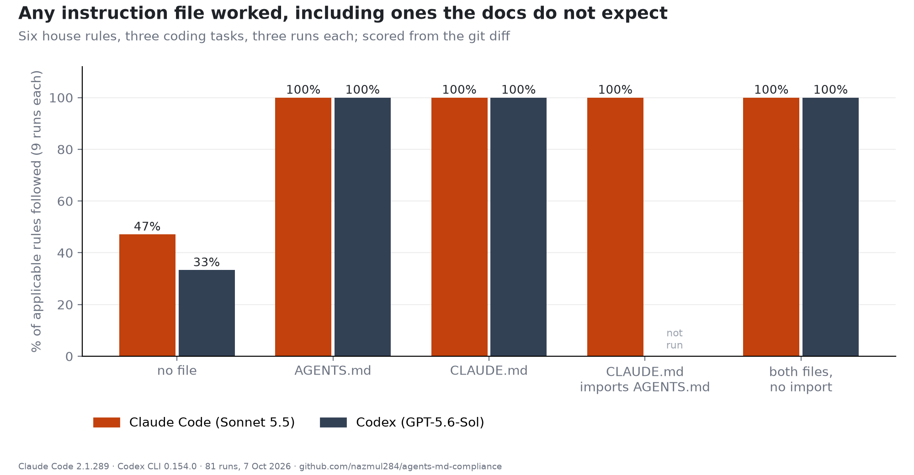

# agents-md-compliance

Do Claude Code and Codex follow an AGENTS.md, a CLAUDE.md, both, or neither? Six checkable house
rules in an instruction file, three coding tasks on a small fixture project, five
instruction-file arrangements, three runs each: 81 runs, scored from the git diff, plus 3 traced runs and 24 runs in a 2,014-file version of the project. Companion to
*Codex Followed a CLAUDE.md It Isn't Documented to Read: 81 Runs Testing AGENTS.md vs CLAUDE.md*.



## Results

```
Rules followed, all three tasks x three runs per cell (9 runs)

instruction files        Claude Code       Codex
---------------------   ------------  ----------
no file                    47% (0/9)   33% (0/9)
AGENTS.md                 100% (9/9)  100% (9/9)
CLAUDE.md                 100% (9/9)  100% (9/9)
CLAUDE.md imports it      100% (9/9)     not run
both, no import           100% (9/9)  100% (9/9)

(n/9) = runs that followed every applicable rule


With no instruction file: which rules happened anyway

rule                     Claude Code       Codex
---------------------   ------------  ----------
docstring 'Summary:'             0/6         0/6
no print()                       6/9         6/9
CHANGELOG entry                  9/9         2/9
test_spec_ names                 0/9         0/9
marker comment                   0/9         0/9
no new deps                      9/9         9/9
```

## Large-repo follow-up

```
Same tasks in a 2,014-file version of the project (2 runs x 3 tasks)

agent, instruction files          compliant  opened file
-------------------------------   ---------  -----------
Codex, CLAUDE.md only                   6/6          6/6
Codex, AGENTS.md                        6/6          0/6
Claude, both, no import                 5/6          6/6
Claude, CLAUDE.md                       6/6          0/6

'opened file' = the agent itself read the instruction file with a tool;
auto-loaded files never need to be opened.
```

`python harness/make_large_fixture.py` builds the 2,014-file fixture; `python harness/run_large.py <work_dir> --reps 2` runs it.

## Layout

```
fixture/                      the project each run starts from
harness/rules.md              the six rules, written into AGENTS.md and/or CLAUDE.md
harness/run.py                conditions, tasks, agent invocations; resumable
harness/check.py              the scorer (git diff against the baseline commit)
harness/trace_claude.py       re-runs the trap condition with stream-json to capture tool calls
results/runs/*.json           one record per run
results/trace.json            the three traced Claude runs, with their first tool calls
results/codex_logs_claude_md/ Codex event logs for the CLAUDE.md-only runs (paths scrubbed)
results/large/*.json          the 24 large-repo runs, with which instruction file each agent opened
harness/output_stream.py      where each instructed CLI report sends its output (stdout vs stderr)
```

## Reproduce

```
python harness/run.py /tmp/agentsmd --reps 3 --jobs 2      # needs claude and codex CLIs, logged in
python harness/trace_claude.py /tmp/agentsmd
python harness/analyze.py
```

Agents: Claude Code 2.1.289 with claude-sonnet-5-5; Codex CLI 0.154.0 with gpt-5.6-sol; both
headless with permissions bypassed and user settings disabled. Run date 7 October 2026.

## License

MIT
